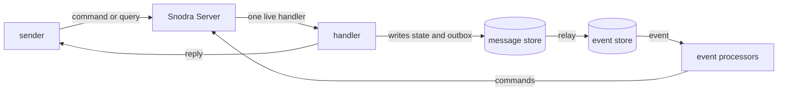

# Core concepts

Snodra is a CQRS-style messaging stack. These pages explain the ideas in the order they build on
each other, for someone who has not used CQRS before. Each page ends at the reference page that
implements the idea.

| Concept | In one sentence |
|---|---|
| [CQRS](cqrs.md) | Commands and queries are separate paths because writes and reads have different shapes and failure modes. |
| [Commands](commands.md) | A command asks exactly one service to change something and returns a result. |
| [Queries](queries.md) | A query asks for data; it may be answered by one handler, many handlers, or a stream. |
| [Events](events.md) | An event states that something happened and is delivered to every interested service. |
| [Event sourcing](event-sourcing.md) | What Snodra stores, and what it deliberately leaves to your own database. |
| [Sagas](sagas.md) | A long-running process that reacts to events, sends commands and handles timeouts. |
| [Event processors](event-processors.md) | The named consumers that read events, with their own group, status and dead letters. |
| [Consistency](consistency.md) | What the outbox guarantees, what it does not, and how to reason about duplicates. |

## How the pieces fit

The server moves commands and queries between live instances. It keeps no state. Events do not pass
through it: a handler writes its state and an outbox entry in one transaction, and a relay moves the
outbox entries to the event store. Consumers read events from there and mark what they processed in
the message store.

If you only read one page before writing code, read [Commands](commands.md) and
[Consistency](consistency.md).

## Reference

- The complete messaging model: [the messaging model](../messaging/index.md).
- The server contract: [Protocol](../server/protocol.md).
- The Kotlin library: [API](../messaging/kotlin/api.md).
- The Rust library: [API](../messaging/rust/api.md).
