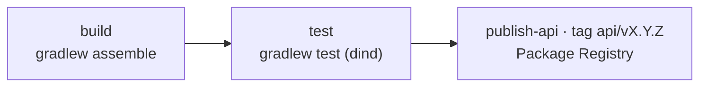

# Modules, build and examples

## Modules

| Module | Coordinates | Purpose |
|---|---|---|
| `snodra-messaging-api` | `com.damoreira.snodra:snodra-messaging-api:0.1.0-SNAPSHOT` | `@MessageType`, `Event`, `Command<R>`, `Query<R>`, `StreamingQuery<R>`. No Spring. Depended on by every `*-api` module. |
| `snodra-messaging` | `com.damoreira.snodra:snodra-messaging:0.1.0-SNAPSHOT` | Spring Boot starter: buses, handler annotations, hub client, outbox, Kafka consumer, sagas, deadlines and the external-integration toolkit, auto-configuration. |
| `snodra-messaging-test` | `com.damoreira.snodra:snodra-messaging-test:0.1.0-SNAPSHOT` | `InMemoryBuses`, `InProcessHub`, `KrakenContainers`, `KrakenTestKafka`, `SagaTestFixture`. |
| `examples/examples-api`, `examples/service-a`, `examples/service-b` | not published | Two sample services talking through the hub; see [Examples](#examples). |

## Requirements

- JDK 25 (Temurin), found on the PATH or by the Gradle toolchain resolver.
- Docker for the container tests (Kafka, MongoDB, and the hub image for the end-to-end test).

Rancher Desktop: Testcontainers needs two environment variables, otherwise it does not find the Docker socket.

```bash
export DOCKER_HOST=unix://$HOME/.rd/docker.sock
export TESTCONTAINERS_DOCKER_SOCKET_OVERRIDE=/var/run/docker.sock
```

or the equivalent lines in `~/.testcontainers.properties`:

```properties
docker.host=unix:///Users/<you>/.rd/docker.sock
testcontainers.docker.socket.override=/var/run/docker.sock
```

## Build, test, publish

```bash
./gradlew build                  # compile + all tests (needs Docker, see above)
./gradlew publishToMavenLocal    # installs 0.1.0-SNAPSHOT into ~/.m2 for the service repos
```

Publishing to the GitLab Package Registry happens in CI on tags matching `api/vX.Y.Z`: the `publish-api` job sets
`SNODRA_GITLAB_MAVEN_URL` and authenticates with `CI_JOB_TOKEN`, then publishes all three modules with the tag's version.
Locally, set `SNODRA_GITLAB_MAVEN_URL` and `SNODRA_GITLAB_TOKEN` and run `./gradlew publish`.

The published POM and Gradle module metadata carry resolved versions for every dependency (Gradle `versionMapping`), and the
POM also imports the Spring Boot BOM, so consumers do not need to manage them.

## Examples

`examples/` holds two tiny Spring Boot services built on this starter: service-a sends a command and a query over
the hub and reacts to an event, service-b owns the command and the query and publishes the event. They run in
Docker Compose from local builds together with the real `snodra-server` image, Kafka and MongoDB, and are driven with
`curl`. service-b also runs a saga against a fake partner (the postcard printer) over all three inbound channels; see
[Sagas](api.md#sagas) and `examples/README.md`.

## CI/CD pipeline

Defined in ``.gitlab-ci.yml``; runs on every push and merge request on
`eclipse-temurin:25-jdk`.



| Stage | Job | Runs | Produces |
|---|---|---|---|
| build | `build` | always | compiled modules |
| test | `test` | always, with a `docker:dind` service; the hub end-to-end test is skipped when the hub image is not reachable | JUnit report |
| publish | `publish-api` | only on tags `api/vX.Y.Z` | `snodra-messaging-api`, `snodra-messaging` and `snodra-messaging-test` at `X.Y.Z` in the Package Registry |

Consumers resolve the artifacts from the group endpoint
`https://registry.example.com/repository/maven-public/`. No Docker image is built: this
is a library; the example services are built from source by the sandbox compose.

## Known limitations

- Hub authentication is a static token per service (P5a), a Keycloak client-credentials JWT (P5b) or a client certificate (P5c, mTLS).
  A static token is a long-lived secret: rotate it through `hub.token-file`. An access token that Keycloak revokes keeps working until
  it expires (minutes); a certificate until its `notAfter` or until the hub's `[[service]]` table is removed (no CRL, no OCSP: issue
  short-lived certificates). A client key must be unencrypted PKCS#8 PEM. With a single hub, a certificate rotation leaves the instance
  without a stream for a moment (see the rotation notes above).
- Event processors (P6a) are observed, not controlled: no pause, resume, reset or replay, and retry or discard of dead letters only
  through the service's own `DeadLetters` bean (the hub's control plane is P6b). Attempts and back-off are shared by all processors;
  one consumer thread per processor and instance.
- No leader election for the outbox publisher; with several instances delivery is at-least-once and ordering is per
  publishing instance.
- A stream pins one handler instance for its whole life: a restart of that instance fails the stream
  (`HANDLER_DISCONNECTED`), and the library never resumes it. A subscription's update targets are fixed when it opens
  (at-most-once updates): an instance that starts later is never added and the library never resubscribes, so a
  subscriber that must hear every instance resubscribes itself (opt-in auto-resubscribe is future work).
- Library metrics are limited to the credential counters of P5b and the saga toolkit's (see [Sagas](api.md#sagas)), both Micrometer and optional; there are no metrics for the buses, the outbox or the consumer yet. OpenTelemetry comes from the application.
- Configuration metadata is hand-maintained in `META-INF/spring-configuration-metadata.json`.
- `TraceHeaders` is only active with Micrometer Tracing on the classpath.
- Trace context is injected on outbound messages (hub requests, outbox events) but not yet extracted on inbound hub
  requests or Kafka records, so a handler's spans do not join the caller's trace.
- No service-to-service identity yet: commands sent from event handlers, sagas or scheduled jobs carry no token, so they can
  only reach handlers without `@RequiresAuthentication` (a `kraken-system` client-credentials token is future work).
- Sagas: Kotlin only (the Rust crate follows, S2); a new saga type does not see events from before its deployment (no replay);
  parked saga events are retried by a person through `SagaFailures`; a saga belongs to one service.
- Sagas, reviewed and left as they are: `saga_dispatch` entries that failed for good and `saga_failures` documents have no TTL; a
  `startKey` is `"<type>|<key>=<value>"`, so an association key that contains `=` can make two pairs share one live instance
  (avoid `=` in keys); the smoke test does not check that a restart replays nothing twice (the tests do).
