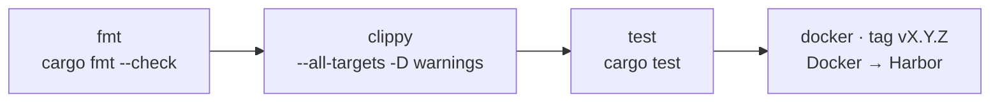

# Modules and build

## Build and test

```bash
brew install cmake protobuf          # librdkafka is built from source; protoc for the proto
cargo build
cargo test                            # unit tests + integration tests (Docker required for the latter)
```

Integration tests start Kafka (`apache/kafka`), MongoDB (replica set) and `snodra-server:dev` with
testcontainers. The hub image is built from the sibling repo: `docker build -t snodra-server:dev .` in
`../snodra-server` (override with `SNODRA_SERVER_IMAGE`); every end-to-end test runs that one image (the
hub and this library ship together). `tests/e2e_protocol.rs` covers the handshake, timeouts,
reconnect, flow control and status reports against it; `tests/e2e_multi_hub.rs`,
`tests/e2e_scatter.rs`, `tests/e2e_stream.rs` and `tests/e2e_subscription.rs` run two hubs;
`tests/e2e_auth.rs`, `tests/e2e_jwt.rs` and `tests/e2e_mtls.rs` run it in `enforce` with an ACL
file and certificates generated at test time (written under `target/tmp` and bind-mounted into
the container); `tests/hub_pool.rs` runs
the multi-hub rules against in-process fake hubs. Without Docker the integration tests print a notice and skip; with Docker but no hub
image they fail with the build command. On Rancher Desktop export
`DOCKER_HOST=unix://$HOME/.rd/docker.sock` first. A unit test and `scripts/check-proto-sync.sh` (CI
job `proto-sync`) check that `proto/hub.proto` is byte-identical to `../kraken/protocol/hub.proto`
whenever the umbrella checkout exists.

## Example

`examples/service-c` is a complete service: it handles `Shout` and `Reverse`, publishes
events, consumes `GreetingDelivered`, runs the banner saga (`src/banner.rs`: an idempotent printer adapter, a partner topic,
a webhook on axum and a polling deadline, unit-tested with `SagaTestFixture`), and runs in the sandbox compose next to the
Kotlin examples.

## CI/CD pipeline

Defined in ``.gitlab-ci.yml``; runs on every push and merge request on a Rust image
with `protobuf-compiler` installed.



| Stage | Job | Runs | Produces |
|---|---|---|---|
| fmt | `fmt` | always | formatting check |
| clippy | `clippy` | always | lint with warnings as errors |
| test | `test` | always | unit and in-process integration tests |
| docker | `docker` | only on tags `vX.Y.Z` | `gdamoreira/snodra-messaging-rs:vX.Y.Z` and `:latest` |

The crate is consumed as a git dependency pinned to a tag, so the image job mainly proves the Dockerfile; the sandbox compose builds `examples/service-c` from source.
