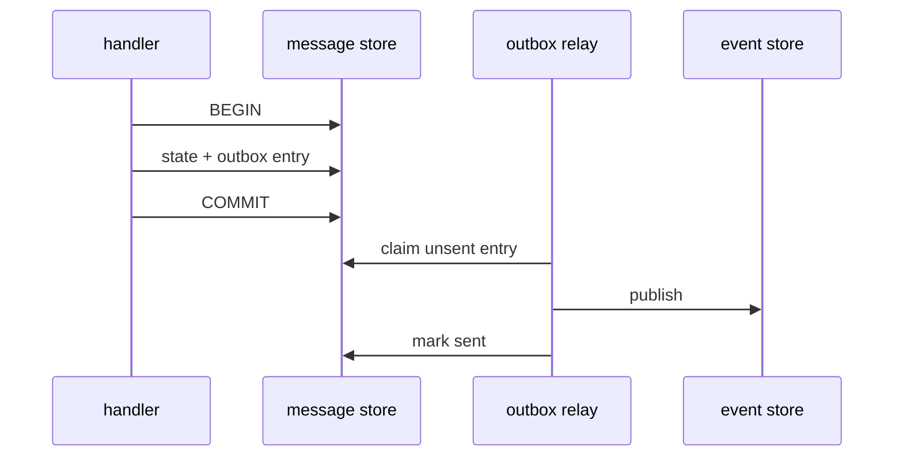

Snodra gives you clear guarantees, and it is just as important to know what they are not. This page
covers the outbox, duplicates, ordering and the outcome of a failed command.

## The outbox

A command handler writes its state and an outbox entry in **one transaction**. A relay reads the
outbox and publishes to the event store. If the transaction rolls back, no event exists. If the
process dies after the commit, the entry is still there and is published later.

## What is guaranteed

| Guarantee | Meaning |
|---|---|
| **Atomic write and event** | The state change and the outbox entry commit together or not at all. |
| **At-least-once publish** | A committed outbox entry is published eventually; a crash can publish it twice. |
| **At-least-once consume** | A processor can see a record again after a crash, rebalance or replay. |
| **Duplicate suppression** | The processed-event marker skips an event the service already handled. |
| **Order per key** | Events with one key keep their order in one event store. |
| **Retention** | Outbox, markers and dead letters expire after their configured retention. |

## What is not guaranteed

- **Exactly-once across services.** Two services may react in either order; a reader may see the
  effect of one before the other.
- **Read-your-writes outside the writing service.** Another service sees an event only after the
  relay publishes it.
- **Global order.** There is no total order across keys, partitions or event stores.
- **A command's outcome after `TIMEOUT`.** The handler may have run. Retrying a command after a
  timeout can execute it twice; make the handler idempotent or query the result.
- **No loss on an unbounded outage.** If the outbox fills the database or the broker is gone longer
  than the retry and retention settings allow, entries can be marked failed or expire. Watch
  `snodra_outbox_pending` and `snodra_outbox_oldest_age_seconds`.

## Where it is implemented

- The outbox, markers and their retentions: [the messaging model](/docs/messaging/).
- Store-specific guarantees: [MongoDB message store](/docs/add-ons/mongodb-message-store/) and
  [SQL message store](/docs/add-ons/sql-message-store/).
- Delivery and lag metrics: [Monitoring](/docs/operations/monitoring/).
- Retry policy and deadlines: [Commands](/docs/concepts/commands/) and [Tuning](/docs/operations/tuning/).
