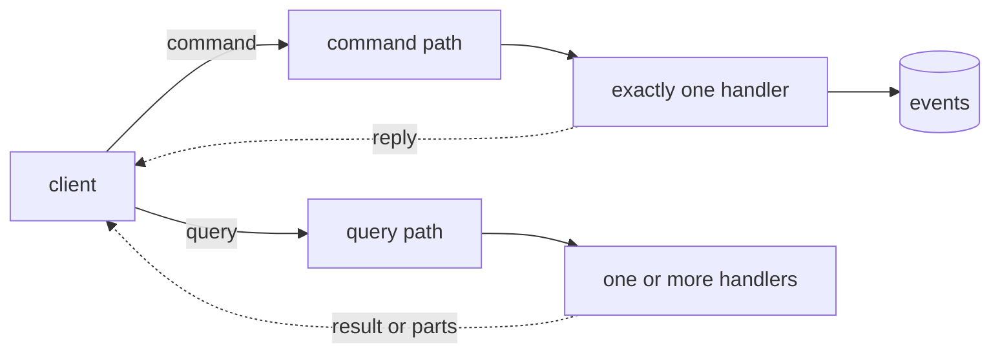

CQRS means **Command Query Responsibility Segregation**: the path that changes state and the path
that reads it are designed apart. It is not a requirement to use two databases, and Snodra does not
force one. It is a way to stop a single model from serving two jobs badly.

## The two jobs

A **command** asks a service to do something: place an order, log a workout, attach a file. It has a
target, an intent and a result. It must reach exactly one handler, and the caller usually waits for
the answer.

A **query** asks for data. It may be answered by one service, by every instance of every service that
knows the answer, or as a stream of parts. It never changes state.

In a single model, both paths share one API and one consistency rule. That couples the write path to
read latency and read scaling: a slow report makes writes slow, and a write schema change breaks a
read screen. CQRS separates them, so each side can fail, scale and evolve on its own.

## What Snodra adds

- **Routing by type.** The server knows which live instance handles a command or query type and
  forwards the request. There is no service registry to maintain.
- **One failure model.** Commands and queries get a deadline, a status code and a defined outcome
  when the handler disappears.
- **Events as the write-side output.** State changes publish events through the outbox, so other
  services react without the sender knowing them.

## What it does not mean

You do not need event sourcing to use CQRS. Snodra stores events for other services to consume; the
state behind a query stays in the service's own database. See
[Event sourcing](/docs/concepts/event-sourcing/).

Next: [Commands](/docs/concepts/commands/), [Queries](/docs/concepts/queries/). The server side is in
[Protocol](/docs/server/protocol/) and [Routing](/docs/server/routing/).
