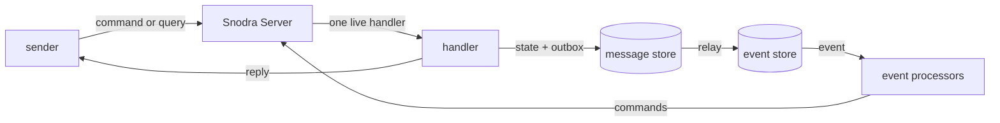

import { CardGrid, LinkCard } from '@astrojs/starlight/components';

## Start here

<CardGrid>
  <LinkCard
    title="Getting started"
    href="/docs/getting-started/"
    description="Install the server, add the client you write in, and send a first command."
  />
  <LinkCard
    title="Core concepts"
    href="/docs/concepts/"
    description="CQRS, commands, queries, events, sagas, processors and the consistency model."
  />
  <LinkCard
    title="Snodra Server"
    href="/docs/server/"
    description="Routing, authentication, settings, the dashboard, processor control and the protocol."
  />
  <LinkCard
    title="Kotlin library"
    href="/docs/messaging/kotlin/"
    description="The Spring Boot starter: buses, handlers, outbox, sagas and testing kits."
  />
  <LinkCard
    title="Rust library"
    href="/docs/messaging/rust/"
    description="One builder for the hub client, event store, outbox, processors and sagas."
  />
  <LinkCard
    title="Go library"
    href="/docs/messaging/go/"
    description="The Go client at feature level 4: commands, queries, events, processors, control, dead letters, sagas and external calls."
  />
  <LinkCard
    title="Python library"
    href="/docs/messaging/python/"
    description="The Python client at feature level 4: commands, queries, events, processors, control, dead letters, sagas and external calls."
  />
  <LinkCard
    title="Add-ons"
    href="/docs/add-ons/"
    description="Kafka or RabbitMQ Streams for events; MongoDB, PostgreSQL or MySQL for state."
  />
  <LinkCard
    title="Writing a library"
    href="/docs/library-authors/"
    description="The protocol, the message rules, feature levels and the conformance contract."
  />
  <LinkCard
    title="Operations"
    href="/docs/operations/"
    description="Monitoring, testing, tuning and upgrades for a system in production."
  />
  <LinkCard
    title="Integrations"
    href="/docs/integrations/"
    description="Spring Boot, OAuth2, OpenTelemetry, containers and existing services."
  />
  <LinkCard
    title="Tools"
    href="/docs/tools/"
    description="The event browser and the conformance runner."
  />
  <LinkCard
    title="Migration"
    href="/docs/migration/"
    description="Compatibility and the paths from an existing messaging stack."
  />
</CardGrid>

## The shape of a Snodra system

The server holds no state and events never pass through it. State and the outbox live in your
message store, events live in your event store, and the libraries give every service the same
delivery, retry and saga semantics. Start with [Getting started](/docs/getting-started/) or read
[the concepts](/docs/concepts/) first.
