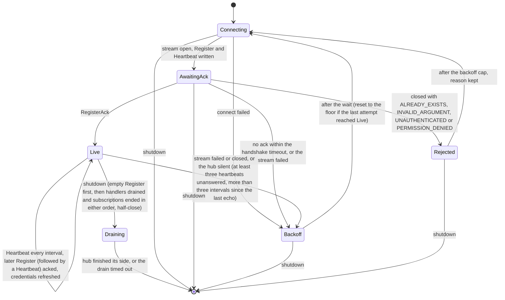
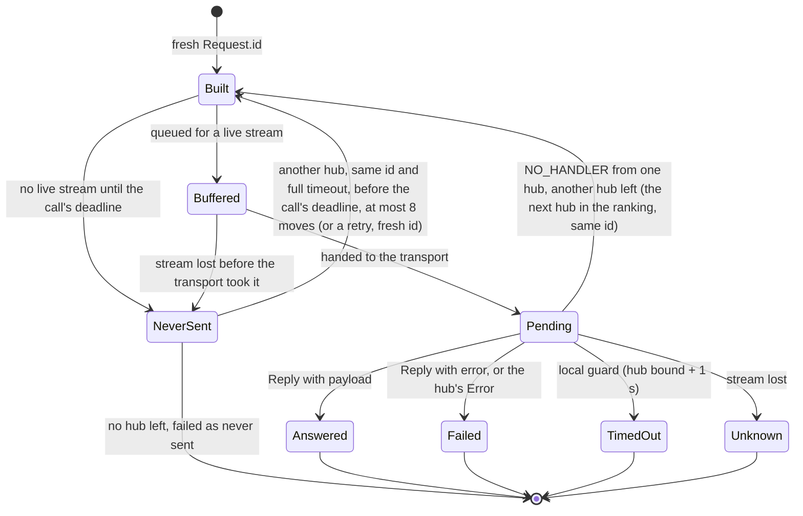
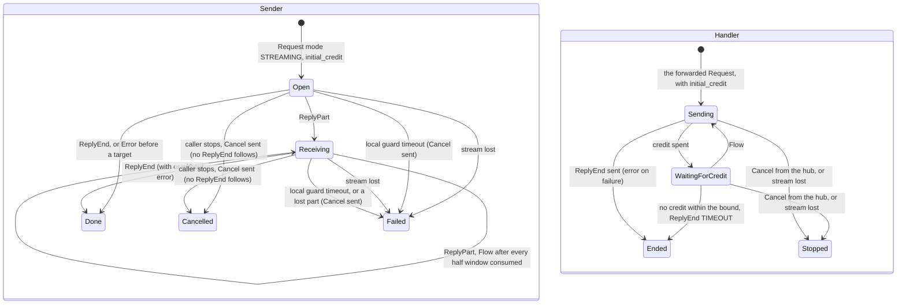
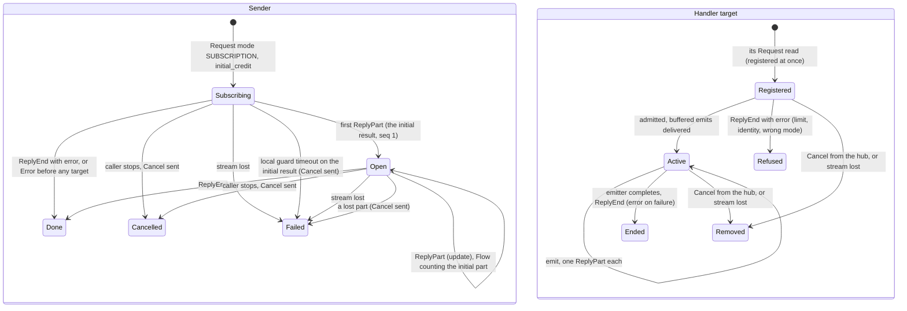

This page is for anyone writing a Snodra library for a new language (TypeScript, C#, ...). After reading
it you know in which order to build one so that each step can be tried against a real hub, the states a connection, a
request, a stream and a subscription go through, and the mistakes the official libraries made on the way, each as a
rule with its reason. The protocol itself is in [protocol.md](/docs/library-authors/protocol/), the messages in [messages.md](/docs/library-authors/messages/),
the levels and their checks in [feature-levels.md](/docs/library-authors/feature-levels/). The official libraries are reference
implementations ([Kotlin](/docs/messaging/kotlin/), [Rust](/docs/messaging/rust/),
[Go](/docs/messaging/go/), [Python](/docs/messaging/python/)), never the specification. The Kotlin library is the reference: where these pages are
silent, its behaviour decides.

## Before you start

- **Bindings.** Generate the gRPC types and the `Hub.Connect` client from
  [`proto/hub.proto`](https://github.com/snodra/snodra-server/blob/main/proto/hub.proto) with your language's protobuf and gRPC tooling. You need
  bidirectional streaming and HTTP/2 keepalive pings.
- **A hub to try against.** The `snodra-server` image ([Hub quick start](/docs/server/quickstart/)) runs with its
  defaults (plain text, access control off, gRPC on port 7000, dashboard on 7001); its dashboard shows your instance, its types, permits and status as the hub sees them.
- **A name.** `snodra-messaging-<language>` is the suggested name for a community library
  ([index.md, Add your library](/docs/library-authors/#add-your-library)).

## Build order

Each step ends with something to try against a real hub; levels are in [feature-levels.md](/docs/library-authors/feature-levels/).

1. **Types and payloads**: message type names, the JSON codec with the payload rules
   ([messages.md](/docs/library-authors/messages/)).
2. **One stream**: `Register`, `Heartbeat`, the `RegisterAck`, the heartbeat cadence, the silent-hub check,
   reconnect with backoff, registration refusals ([protocol.md, Connect and register](/docs/library-authors/protocol/#connect-and-register)).
   Watch the instance appear on the dashboard and come back after a hub restart.
3. **Handling unary requests**: dispatch by type, the error mapping, one terminal message per request, permits
   ([protocol.md, Handling a request](/docs/library-authors/protocol/#handling-a-request), [Flow control](/docs/library-authors/protocol/#flow-control)).
4. **Sending unary requests**: request ids, the pending map, timeouts, never sent versus outcome unknown, the error
   codes ([protocol.md, Requests](/docs/library-authors/protocol/#requests)). Two instances of your library can now talk, and so can yours
   and an official one.
5. **Identity and propagation**: the forwarded `authorization` header, its validation before the handler, the
   correlation id and trace context ([messages.md](/docs/library-authors/messages/#request-headers)).
6. **Credentials**: a static token, then a JWT with its refresh, then client certificates and TLS
   ([protocol.md, Credentials](/docs/library-authors/protocol/#credentials)).
7. **Query modes**: shared types and scatter-gather (nothing new on the handler side), then streaming, then
   subscriptions ([protocol.md, Query modes](/docs/library-authors/protocol/#query-modes)).
8. **Several hubs**: one connection per hub, routing, the permit split and top-up, failover, `InstanceStatus`
   ([protocol.md, Several hubs](/docs/library-authors/protocol/#several-hubs)). This completes **level 1**.
9. **Events**: the message-store interfaces with an in-memory store and the store kit, the event-store interfaces with
   an in-memory event store and its kit, the outbox relay, the consumer ([level 2](#level-2-events)). Port the kits
   first: they are the specification of the add-ons ([event-store-add-ons.md](/docs/library-authors/event-store-add-ons/),
   [message-store-add-ons.md](/docs/library-authors/message-store-add-ons/)).
10. **Processors**: named processors, status, control, dead letters, replay ([level 3](#level-3-processors)).
11. **Sagas** and deadlines ([level 4](#level-4-sagas)).

## State machines

### A connection to one hub

Requests may arrive in AwaitingAck: serve them. On every transition out of Live, the requests written to the stream
have an unknown outcome, the ones still in the library's own buffer were never sent, and the streams, subscriptions and
handlers bound to the stream end ([protocol.md, A lost stream](/docs/library-authors/protocol/#a-lost-stream)).

### A unary request the library sends

A request is pending until exactly one of a reply, an error or its local guard; a late answer for an id no longer
pending is dropped.

### A stream, on both sides

The handler holds its permit from the request to Ended or Stopped, and sends nothing after Stopped.

### A subscription, on both sides

The initial result is a separate unary request `<id>#0` to one of the targets, served like any unary request; the
target recognises it by its `#0` id. The hub sends a subscription type no other unary request, because the service
declares the type in `Register.subscription_query_types`.

## Pitfalls the official libraries met

Each is a rule, with the reason it exists and the check that proves it.

**Connection**

- **Treat the `RegisterAck` as the handshake, never the heartbeat echo** (`L1-HANDSHAKE-ACK`). Clients first treated the
  echo as the registration's confirmation; the ack replaced it
  because it carries what the client must apply (the heartbeat interval, the timeout rules, the hub id), and the hub
  writes it before the echo of the heartbeat that follows the `Register`. A client that went live on an echo would
  heartbeat and time out on guesses, and could not tell two targets of one hub apart.
- **Drop a silent hub only when both more than three intervals passed and at least three heartbeats are unanswered,
  and only after the ack** (`L1-SILENT-HUB`). A rule on the time since the last echo alone drops a healthy stream when
  a tick fires a little late, exactly three intervals after the echo; a check before the ack drops a slow handshake
  that the handshake timeout is there to wait for.
- **Follow every `Register` with a `Heartbeat`, a later one too** (`L1-SILENT-HUB`): the hub answers the heartbeat
  after the `Register` has been read, so its echo shows the hub is alive at that point, and the heartbeat counts toward
  the silent-hub rule like any other.
- **Serve requests that arrive before the ack** (`L1-EARLY-REQUESTS`): the hub routes to an instance as soon as its
  `Register` is processed, so dropping them fails a sender's request for nothing.
- **A refused `Register` is not fatal** (`L1-REJECTION`): two services registering one type is a deployment error; a
  service that crashed on it would turn one bad deploy into an outage, and one that retried at once would hammer the
  hub. Retry at the backoff cap and say why.
- **Leave the hubs in order at shutdown** (a should, not checked yet;
  [protocol.md, Shutting down](/docs/library-authors/protocol/#shutting-down)): first a `Register` with no types to every hub, so the hub
  routes what it queued for the instance elsewhere at once instead of when the session ends; then end the served
  subscriptions and drain the handlers, in either order; then half-close each stream, waiting (bounded) for the hub to
  finish its side. Dropping
  the stream resets the RPC and discards what the transport had not written yet, such as a subscription target's last
  updates and its `ReplyEnd`; the hub would then fail the subscription with `ErrorCode.HANDLER_DISCONNECTED`.

**Requests**

- **Send exactly one terminal message per request id** (`L1-ONE-TERMINAL`). The hub matches answers by id and drops
  what comes for an id it no longer waits for; a request left without its terminal message keeps the sender waiting
  until its timeout and keeps the permit counted; anything sent after the hub's `Cancel` is for an id the hub already
  forgot.
- **Answer on the stream the request arrived on** (`L1-ARRIVAL-STREAM`). After a reconnect the new stream is another
  session: the hub accepts an answer only from the session it forwarded the request to, and has already failed the
  request with `ErrorCode.HANDLER_DISCONNECTED`.
- **A failed nested call is the handler's `ErrorCode.HANDLER_ERROR`** (`L1-HANDLER-ERRORS`). `ErrorCode.NO_HANDLER`
  tells a sender that no handler ran, which makes a command safe to retry; a handler that passed its own downstream
  `ErrorCode.NO_HANDLER` through would get a command that already did part of its work run again.
- **Refuse an anonymous caller before decoding the payload, and apply the handler's rule after decoding**
  (`L1-IDENTITY`): an anonymous caller cannot learn payload shapes from the decode errors, and a rule may read the
  message, so a malformed payload from a caller with the wrong role gets `ErrorCode.INVALID_REQUEST`
  ([messages.md, Forwarded identity](/docs/library-authors/messages/#forwarded-identity)).
- **A guard needs a JWKS, and an unverified token is no identity** (a library's own test). Claims read without the
  issuer's keys can be forged by anyone who reaches the hub; a guard without a JWKS could only refuse every caller, so
  registering one is a startup error ([messages.md, Forwarded identity](/docs/library-authors/messages/#forwarded-identity)).
- **Send `Request.timeout_ms` = 0 unless the caller chose a timeout** (`L1-TIMEOUT`). When clients always sent a
  value, the hub's per-type timeouts could never apply. The local
  guard waits one second longer than the hub's bound, so the hub's answer, which says what happened, normally comes
  first.
- **A retry never sends 0 as its timeout** (`L1-RETRY`): 0 means "the hub's default", which can be longer than what
  is left of the caller's budget. Send the remainder, at least 1 ms.
- **Only what never left your own buffer was never sent** (`L1-NEVER-SENT`, `L1-HUB-FAILOVER`). A request still in the
  library's outbound buffer when its stream breaks can go to another hub with the same id; one the transport took may
  be on the wire, and resending it could run a command twice.
- **A moved request keeps its full timeout, and one deadline bounds the call** (`L1-HUB-FAILOVER`). Each hop is a new
  request to a hub, which bounds it on its own, so it carries the caller's timeout whole; the call's deadline, at most
  8 moves and no new hop after the deadline keep a request whose streams keep breaking from moving for ever.

**Flow control and several hubs**

- **Give a permit back at once when the hub runs low** (`L1-PERMITS`): with batching alone, an instance with one
  permit is paced by the batching timer at about 20 requests per second.
- **Split permits over the hubs and top them up when one goes** (`L1-HUB-PERMITS`). Each hub holds the permits of its
  own session and never learns that another hub went down; without the top-up and its `Permits.grant`, the survivor
  keeps its share as a cap and the instance runs at a fraction of its capacity after an outage. Offering at most the
  new share per stream keeps repeated flaps from adding up, and never revoking keeps a hub's queue from stalling.
- **One address family from DNS, one stream per `RegisterAck.hub_id`** (`L1-HUBS`). A dual-stack name lists every hub
  twice, and two streams of one instance id to one hub replace each other at the hub, over and over.
- **Park a duplicate address, never close it for good** (`L1-HUBS`). Connect it again once no kept target owns its hub
  id: behind aliases, an address closed for good leaves the instance one hub short after a rolling restart of the
  hubs.
- **Keep a hub being rolled over to a renewed certificate in the permit split** (`L1-HUB-PERMITS`). Its new stream
  offers `ceil(max / N)` again; counting it out would offer it the share of every hub while the others still hold
  theirs.

**Query modes**

- **Declare the subscription types in every `Register`** (`L1-SUBSCRIBE`). The hub serves a subscription of a declared
  type only, so without the list the subscription handlers are unreachable; and the declaration is what lets the hub
  refuse a point query, a stream or a gather of the type, so the handler's `#0` request is always the hub's.
- **Register a subscription the moment its `<id>#n` request is read** (`L1-SUBSCRIBE`), before checking the caller,
  and buffer emits until that check is done. The hub writes `#n` before `#0` to the same instance; a library that
  registered later lost the updates emitted between serving the initial result and registering.
- **Count the initial part as consumed when refilling a subscription's credit** (`L1-SUBSCRIBE`): it took a credit at
  the hub, and a window of 1 never refills otherwise.
- **Bound a streaming handler's wait for credit** (`L1-STREAM`): a hub that forgot the stream (a lost `Flow` or
  `Cancel`) never sends credit, and the handler would hold its task and its permit forever.

**Credentials**

- **Refresh a JWT once per renewal** (`L1-JWT`): the hub looks at one refresh per second per session and drops the
  rest without a reply, so a burst hides the one that mattered. After `UNAUTHENTICATED`, register with a newly fetched
  token (the old one is what the hub refused); after `PERMISSION_DENIED`, do not fetch again (a new token for the same
  client would be refused the same way, and the identity provider is not to be hammered).
- **Reconnect with a renewed client certificate before `notAfter`** (`L1-MTLS`): a TLS session cannot be refreshed on a
  live stream, so the hub closes it at `notAfter` with no grace. The official libraries watch the files, wait a random
  delay so replicas do not all leave at once, and roll their hubs over one at a time.
- **A token file is read again before every connect and on every heartbeat tick of a registered stream**, and a changed
  token goes to the hub as `ClientMessage.credentials`, so a rotated secret needs no reconnect. A file that cannot be
  read or is empty at startup is a startup error; an empty file after a good read is a rotation caught half way: keep
  the last good token (not checked yet: a library's own test).

**Events and processors**

- **Record the processed-event marker and run the handlers in one transaction, and acknowledge after its commit**
  (`L2-CONSUME`): an acknowledgement before the commit loses the event on a crash; a marker outside the transaction
  either skips an event whose handling rolled back or handles it twice.
- **An event-store subscription's `next` must lose nothing when its wait is dropped** (`L2-EVENT-STORE-KIT`): the core
  races it with its shutdown and its timers and drops the losing wait, so an event or an error held inside a dropped
  wait is gone (the Kotlin kit cancels `next` after every slice of reading to catch exactly this).
- **Close what you built when a subscribe is cancelled** (the Kotlin interface says so; not checked yet: no kit check
  cancels a subscribe): a subscription built and then dropped stays a member of the event store's subscription,
  holding segments nobody reads.
- **Handle control requests off the stream's read loop, and answer a lease renewal at once, even during an execute**
  (`L3-CONTROL`, `L3-RESET`): a control action can take seconds or minutes; on the read loop it would stop heartbeats
  and request dispatch, and a renewal queued behind a long execute would let the lock expire under it.
- **Remember the reset operations that ended, and refuse their late renewals** (`L3-RESET`) with
  `ControlRefusal.CONTROL_REFUSAL_NOT_PREPARED`: a renewal that raced the finish would otherwise take the free lock for
  a whole lease and stop every instance.

## Level 2: Events

What a library adds for events:

- **Publish**: build the event (its type, a fresh id, the key, the headers of
  [messages.md](/docs/library-authors/messages/#event-headers)) and append it to the outbox in the caller's transaction (`L2-OUTBOX`).
- **Relay**: every instance runs a relay that claims pending outbox entries under a lease, in `(created_at, seq)`
  order, hands each to the event store with the stored key and headers plus `type`, `id`, `timestamp` and `source`,
  and marks it sent once the event store accepted it. Several instances compete without leader election; an entry may
  be sent twice if an instance dies between the publish and the mark, which consumers absorb.
- **Consume**: per processor, one subscription; per delivery, skip (and acknowledge) a type no handler handles,
  otherwise record the marker and run the handlers in one transaction, then acknowledge (`L2-CONSUME`). A failing
  handler is retried with backoff, then the record becomes a dead letter (level 3) or, at level 2, is logged and
  skipped.
- **Startup**: a service with only command, query and subscription-query handlers needs neither store; anything that
  publishes or handles events without them fails at startup naming the missing add-on (`L2-NO-ADD-ON`).

## Level 3: Processors

What a library adds for processors:

- **Named processors** (`L3-PROCESSORS`): handlers without a processing group run in `default`, the others in their
  group's processor, each with its own subscription and markers; sagas run only in `default`.
- **Status** (`L3-STATUS`): every status tick, one `ProcessorStatus` per processor, built from memory, never blocking
  the stream or the consumer ([protocol.md, Processor status](/docs/library-authors/protocol/#processor-status)).
- **Pause and resume** (`L3-PAUSE`): persisted in the message store's processor control, which every instance reads at
  start and every 5 s; consumption stops without leaving the subscription.
- **Reset** (`L3-RESET`), leased: prepare takes the lock and leaves the subscription; execute (on one instance) plans
  the target with the event store, refuses while members still read the subscription, runs the processor's reset
  handlers when anything replays, deletes the processor's markers in the replay ranges, stores the ranges, then moves
  the positions; finish releases the lock and consumes again. An instance whose lease passes without a renewal
  releases the lock and resumes by itself; an instance that starts under a held lock does not join the subscription
  until the lock is gone. An event store without `replay` answers `ControlRefusal.CONTROL_REFUSAL_UNSUPPORTED`.
- **Replay** (`L3-REPLAY`): while a segment's delivery is below its range's end, the processor's handlers run except
  those marked not to replay, and sagas are skipped; the range closes once the committed position reaches its end.
- **Dead letters** (`L3-DEAD-LETTERS`): a record that exhausts its attempts is parked in the message store (mode
  `collection`, the default), sent to the event store's dead-letter source (`event-store`) or logged and skipped
  (`log`). Letters are `HANDLER_FAILED`, `SEQUENCED` (an earlier letter of the same key is parked: the record waits
  behind it, so order per key holds) or `INVALID` (no type, a payload that is not a JSON object: discard only). The
  hub lists, retries and discards them through control requests.

## Level 4: Sagas

Sagas live in the library, inside the service that owns them, so the hub only ever sees the commands a saga sends,
never the saga itself. The programming model (how a service declares a saga, its handlers, associations and
deadlines) is the official libraries' own and is described in
[Sagas and deadlines](/docs/messaging/#sagas-and-deadlines); a library in another language may give it any shape.
What follows is the part two libraries must agree on, because their sagas send commands to each other's handlers and,
with one message store, share the same records. The records themselves are the message store's saga ports
([message-store-add-ons.md](/docs/library-authors/message-store-add-ons/#the-stores)).

### Applying an event

- A delivered event first runs the processor's event handlers (stage 1, with the `processor:<name>:<eventId>` marker:
  [message-store-add-ons.md, stage-1 marker](/docs/library-authors/message-store-add-ons/#stage-1-marker)), then, in the `default`
  processor, the saga stage (stage 2).
  The saga stage runs after stage 1 committed, and also when stage 1 failed (the failure is reported afterwards, so the
  consumer retries or skips the record by its own rules); the record is acknowledged only after both.
- Per (event, saga type), one transaction records the marker `saga:<sagaType>:<eventId>`, runs the handlers of every
  saga instance the event reaches, and writes each instance's state, its dispatch entries and its deadline changes. A
  redelivered event finds the marker and is skipped (`L4-SAGA-ONCE`).
- An instance's state is written with an optimistic version (0 when created, plus 1 per write): a conflicting write
  aborts the transaction and the event is tried again, so one instance never applies two events at once. An event that
  fails all its attempts is parked as a saga failure together with its marker, so the consumer moves on.

### Dispatching what a saga sends

- A saga never sends during its handling: it records each command and event as a **dispatch entry** in its
  transaction. An entry's `seq` is `version * 1000 + index` (the saga's version after the write, and the message's
  0-based place in that handling, always below 1000), and its id is `<sagaId>:<seq>`.
- A relay in every instance sends the committed entries, one saga's entries in `seq` order under a lease on that saga
  (so two instances never send one saga's entries at once), different sagas in parallel (`L4-SAGA-DISPATCH`).
- An **event** entry is appended to the outbox and marked sent in one transaction, then follows the ordinary outbox
  ([Level 2](#level-2-events)), with the entry's key and the correlation id below.
- An **event** entry the outbox refuses (its payload can never become an outbox entry: not a JSON object, or one the
  store cannot hold) is given up at once, never retried: the entry records that it failed, the reason `INVALID` and
  the message, and the relay logs it at error level. No failure notice follows (the notice is about commands), and the
  saga's later entries are sent as after a failed command. The Kotlin and Rust libraries already refuse such an entry when
  the saga records it; this rule is the backstop for one recorded anyway.
- A **command** entry is sent by its wire type name with its stored JSON payload and its routing key, and with:
    - the headers `idempotency-key` = the entry's id `<sagaId>:<seq>` and `saga-id` = the saga's id;
    - as correlation id, the correlation id of the message whose handling recorded the entry (for a deadline's
      handling, that of the message that scheduled the deadline), and the trace context of the handled event (none
      for a deadline's handling);
    - no `authorization` header and no caller identity: a saga's triggering event is not a caller, so a handler that
      requires an authenticated caller refuses the command;
    - no retry of the sender's own: the relay owns the retries below, and a sender's retry would multiply them.
- A command type the service handles itself goes to its own handler without the hub, unless the service routes every
  request through the hub ([protocol.md, Requests a service answers itself](/docs/library-authors/protocol/#requests-a-service-answers-itself)):
  then it goes through the hub like any other command, and the relay waits for it as for any call through the hub.
  Every other type goes through the hub. A service without a hub knows only its own handlers, whatever that setting.
- A command is marked sent only after its reply, so a crash in between sends it again with the same
  `idempotency-key`: every handler of a saga command must be idempotent by that header.

### Retries and failures

Each attempt's outcome is classified the same way in the Kotlin and Rust libraries, whether the command went through the
hub or to the service's own handler:

| The attempt ended with | Kind | `reason` once given up |
|---|---|---|
| a reply | sent | - |
| never sent (no live hub stream), or the stream broke after the write (outcome unknown) | transient | `EXHAUSTED` |
| `ErrorCode.TIMEOUT` (also the sender's local guard), `ErrorCode.HANDLER_DISCONNECTED`, `ErrorCode.RESOURCE_EXHAUSTED` | transient | `EXHAUSTED` |
| `ErrorCode.NO_HANDLER` from the hub (a redeploy of the target service looks the same) | transient | `EXHAUSTED` |
| `ErrorCode.HANDLER_ERROR` whose `Error.details` is `{"snodra":"retryable"}` | transient | `EXHAUSTED` |
| a failure of the sender that is not a messaging error (its own storage or transport) | transient | `EXHAUSTED` |
| no handler for the type in a service without a hub | permanent | `NO_HANDLER` |
| `ErrorCode.UNAUTHENTICATED` or `ErrorCode.PERMISSION_DENIED` | permanent | `DENIED` |
| `ErrorCode.INVALID_REQUEST` | permanent | `INVALID` |
| `ErrorCode.HANDLER_ERROR` whose `Error.details` is `{"snodra":"unknown-outcome"}` | permanent | `UNKNOWN_OUTCOME` |
| any other `ErrorCode.HANDLER_ERROR` (an unknown code or `ErrorCode.ERROR_CODE_UNSPECIFIED` reads as one), or `ErrorCode.CANCELLED` | permanent | `FAILED` |

- **The markers** (`L4-ADAPTER-MARKERS`). An adapter whose external call may succeed later answers
  `ErrorCode.HANDLER_ERROR` with `Error.details` exactly `{"snodra":"retryable"}`; one that cannot tell whether the
  external call happened answers `{"snodra":"unknown-outcome"}` (UTF-8, no spaces, lower-case `snodra`). The relay
  compares `Error.details`, with surrounding whitespace trimmed, to these bytes; anything else is an ordinary handler
  failure. The markers are the same whether the adapter runs in the saga's service or behind the hub
  ([messages.md, Handler errors](/docs/library-authors/messages/#handler-errors)).
- **A transient failure** counts an attempt and delays the entry, holding back that saga's later entries and no
  other saga's. The wait before attempt n+1 starts at 1 s and doubles up to 5 min, jittered by ±20 % and never above
  the maximum; after 10 attempts in all (the first included) the command is given up as `EXHAUSTED`. These are the
  official libraries' defaults; the attempts and the backoff are configurable.
- **A bound on the wait** (optional). A library may bound how long its relay waits for a command's answer, so that a
  call that never returns (a local adapter has no timeout of its own) cannot hold its saga forever. A send abandoned
  at that bound must count as a transient failure, retried later with the same `idempotency-key`, never as a
  permanent one. Through the hub the bound must not be shorter than the longest the call can take, moves to other hubs
  included ([protocol.md, Several hubs](/docs/library-authors/protocol/#several-hubs)), plus a margin, so the relay never sends a command
  again while a hub may still be running the first. The Kotlin library bounds the
  wait (`snodra.messaging.sagas.relay.send-timeout`, 1 min by default; through the hub at least the longest the call
  can take, its deadline over several hubs plus the last hop's deadline and 1 s, plus 10 s); the Rust crate's relay has
  no such bound.
- **A permanent failure** is a known outcome: the entry records that it failed, the reason, the message and a
  pending notice, in one write, before anything else, so the command is never sent again. The saga's later entries
  are then sent: the saga decides what the failure means.

### The failure notice

A command given up comes back to its saga as a **local** event, never published to the event store
(`L4-COMMAND-FAILED`):

- Type name `snodra.SagaCommandFailed`, a JSON object with the fields `sagaId` (the saga that sent the command),
  `commandType` (the command's wire type name), `idempotencyKey` (its `<sagaId>:<seq>`), `reason` (one of the values
  below, as a string) and `message` (why, for people).
- Its message id, from which its processed-event markers are built, is `failed:<sagaId>:<seq>`; its correlation id is
  the command's.
- It is dispatched inside the service like any event: to the service's ordinary event handlers of that type, and to
  the saga that sent the command, found by `sagaId` (no association needed) while it is live and its type handles the
  notice. Nobody taking it is logged at error and counted, never an error of the relay.
- A notice that cannot be delivered (a handler fails, the store is down) is retried with the same backoff and the same
  number of attempts as a command, then given up (logged at error and counted); its id makes every repeat harmless.

| `reason` | When |
|---|---|
| `NO_HANDLER` | nobody handles the command type, in a service without a hub |
| `DENIED` | the handler requires an authenticated caller, or refuses it: a saga command has none |
| `INVALID` | the handler could not read the payload |
| `FAILED` | the handler failed (any other error) |
| `UNKNOWN_OUTCOME` | an idempotent adapter cannot tell whether its external call happened |
| `EXHAUSTED` | a transient failure lasted through all the attempts |

### Deadlines

A deadline is recorded, and cancelled, in the saga's transaction. A scheduler in every instance claims each due
deadline with a lease, so it fires on one instance and not on each (`L4-DEADLINES`): it loads the saga, runs the
deadline's handler, writes the state and marks the deadline fired, in one transaction. A firing that fails, or whose
instance dies, leaves the claim to expire and fires again after the lease, so a deadline fires at least once, never
before it is due, and never once cancelled or for an ended saga.
