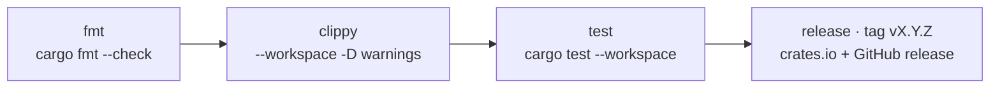

## Build and test

```bash
brew install cmake protobuf          # librdkafka is built from source; protoc for the proto
cargo build
cargo test                            # unit tests + integration tests (Docker required for the latter)
```

Integration tests start Kafka (`apache/kafka`), MongoDB (replica set) and `snodra-server:dev` with
testcontainers. The hub image is built from the sibling repo: `docker build -t snodra-server:dev .` in
`../snodra-server` (override with `SNODRA_SERVER_IMAGE`); every end-to-end test runs that one image (the
hub and this library ship together). `tests/e2e_protocol.rs` covers the handshake, timeouts,
reconnect, flow control and status reports against it; `tests/e2e_multi_hub.rs`,
`tests/e2e_scatter.rs`, `tests/e2e_stream.rs` and `tests/e2e_subscription.rs` run two hubs;
`tests/e2e_auth.rs`, `tests/e2e_jwt.rs` and `tests/e2e_mtls.rs` run it in `enforce` with an ACL
file and certificates generated at test time (written under `target/tmp` and bind-mounted into
the container); `tests/hub_pool.rs` runs
the multi-hub rules against in-process fake hubs. Without Docker the integration tests print a notice and skip; with Docker but no hub
image they fail with the build command. On Rancher Desktop export
`DOCKER_HOST=unix://$HOME/.rd/docker.sock` first. A unit test and `scripts/check-proto-sync.sh` (CI
job `proto-sync`) check that `proto/hub.proto` is byte-identical to the server's
`protocol/hub.proto` in `../snodra-server` whenever that checkout exists.

## Example

`examples/service-c` is a complete service: it handles `Shout` and `Reverse`, publishes
events, consumes `GreetingDelivered`, runs the banner saga (`src/banner.rs`: an idempotent printer adapter, a partner topic,
a webhook on axum and a polling deadline, unit-tested with `SagaTestFixture`), and runs in the sandbox compose next to the
Kotlin examples.

## CI/CD pipeline

Defined in `.github/workflows/ci.yml` and `.github/workflows/release.yml`; the checks run on every push and pull request
on GitHub-hosted Ubuntu runners with the toolchain from `rust-toolchain.toml` and `protoc`.



| Workflow | Job | Runs | Produces |
|---|---|---|---|
| `ci` | `fmt` | every push and pull request | formatting check |
| `ci` | `proto-sync` | every push and pull request | `hub.proto` equals the public server's |
| `ci` | `clippy` | every push and pull request | lint with warnings as errors |
| `ci` | `test` | every push and pull request | the workspace suite, container-backed tests included |
| `release` | `publish` | only on tags `vX.Y.Z` | the core and the four add-ons on crates.io, then a GitHub release |

Services take the crates from crates.io (`cargo add snodra-messaging@0.8`). The sandbox compose builds
`examples/service-c` from source.
